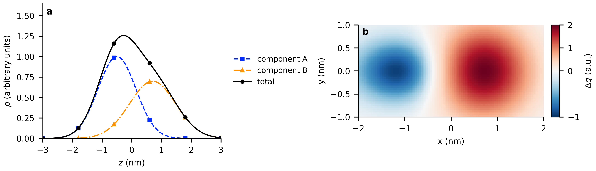
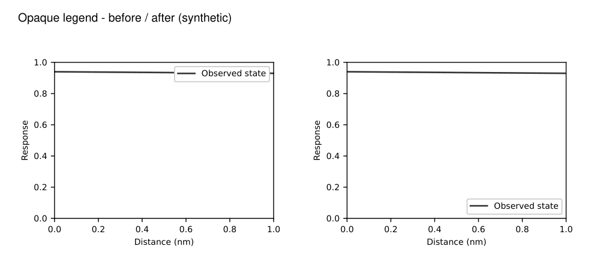

# Journal Figure Kit

**English** | [简体中文](README.zh-CN.md)

**Scientific figures that remain readable at manuscript size.**

[Quick install](#quick-install) · [Examples and validation](docs/validation.md) · [Download v0.10.0](https://github.com/Ychris12138/journal-figure-kit/releases/tag/v0.10.0)

[](https://github.com/Ychris12138/journal-figure-kit/actions/workflows/validate.yml)

An agent skill and Python toolkit for publication figures in Matplotlib. Confirm colors and their meaning, compose at the final physical size, check typography and collisions, and export an editable PDF with a high-resolution PNG.

Built for physics, chemistry and molecular simulation workflows, with installation adapters for Codex, Claude Code, Cursor, Gemini CLI, OpenCode and VS Code Copilot. The skill name remains **`journal-matplotlib`**.

## Quick install

### Short command: install the skill

With Node.js 22.20+ and Git available, run:

```bash
npx skills add Ychris12138/journal-figure-kit
```

Follow the prompts to choose your agent. It installs into the current project by default. To choose Codex directly, append `-a codex`.

This is the shortest route when you already have a Python plotting environment. The [Skills CLI](https://github.com/vercel-labs/skills#readme) copies the canonical skill; it does not configure Python dependencies or run this project's host-specific adapters and update backups. See the [comparison](docs/agents.md#short-install-with-the-skills-cli). Use the full setup below when those features are needed.

### Full setup: install the skill and Python dependencies

With **Python 3.12** installed, paste one command into your terminal. No manual file download, saved installer, Git or Node.js is needed.

**Windows · PowerShell**

```powershell
python -c "from urllib.request import urlopen; exec(urlopen('https://raw.githubusercontent.com/Ychris12138/journal-figure-kit/v0.10.0/install.py', timeout=60).read())" --agent codex --scope user --with-deps
```

**macOS / Linux · Terminal**

```bash
python3 -c "from urllib.request import urlopen; exec(urlopen('https://raw.githubusercontent.com/Ychris12138/journal-figure-kit/v0.10.0/install.py', timeout=60).read())" --agent codex --scope user --with-deps
```

The command runs the installer from the fixed **v0.10.0** tag in memory, downloads and verifies the skill ZIP, and creates a separate Python environment. Network access is required. Omit `--with-deps` if your project already has the plotting dependencies. Reload skills or start a new agent session after installation.

| Agent | Replace `codex` with | How to invoke |
|---|---|---|
| Codex | `codex` | `$journal-matplotlib` |
| Claude Code | `claude-code` | `/journal-matplotlib` |
| Cursor | `cursor` | `/journal-matplotlib` |
| Gemini CLI | `gemini` | Explicitly ask to use `journal-matplotlib` |
| OpenCode | `opencode` | Explicitly ask to load `journal-matplotlib` |
| VS Code Copilot | `copilot` | `/journal-matplotlib` |
| Other agents with file/shell access | `generic` | Provide the installed `SKILL.md` path |

Reuse the command above and change its final arguments:

| Task | Argument change |
|---|---|
| Install several agents with one Python environment | Replace `--agent codex` with `--agent codex claude-code cursor` |
| Install only in the current project | Replace `--scope user` with `--scope project` |
| Upgrade an existing install, saving a ZIP backup | Append `--update` |
| Check installed files and dependencies | Replace `--with-deps` with `--check` |
| Preview destination paths | Replace `--with-deps` with `--dry-run` |

The online command always fetches the installer, including for checks and previews. A preview does not download the skill/dependencies or write installation files. An update preserves local modifications in the backup, not by merging them into the new version.

[Detailed options, local/offline installation and host compatibility](docs/agents.md). Installation and metadata are tested; live model sessions in every host have not been benchmarked.

### Install through Codex

You can also ask Codex to install directly from the repository:

```text
Use $skill-installer to install
https://github.com/Ychris12138/journal-figure-kit/tree/v0.10.0/skills/journal-matplotlib
```

That route copies the skill without setting up Python dependencies. Use the terminal command with `--update --with-deps` to add its environment, or install the bundled `requirements.txt` in your chosen environment. Chinese palette previews need a CJK font such as Microsoft YaHei, Noto Sans CJK SC or SimHei.

## What it helps with



*Synthetic example. The repository contains no private research data or copied paper figures.*

| Figure problem | Approach |
|---|---|
| Large borders or wasted outer space | Construct a fixed-size canvas, allocate panels, legends and colorbars explicitly, and measure exported margins. |
| Arbitrary or inconsistent colors | Show versioned color cards, confirm the mapping to physical quantities, and reuse that approval for layout-only changes. |
| A reference figure has the colors you want | Separate data colors from backgrounds and annotations, propose approximate color cards, then confirm before recoloring. |
| Text becomes tiny in the manuscript | Plan font sizes at the intended placement width; support overall scaling and role-specific overrides. |
| Legends, labels or titles cover content | Measure rendered decorations and isolated data ink; try bounded repairs or reserve a separate region. |
| Multi-panel figures need standalone exports | Regenerate complete panels with consistent data, colors, units and normalization. |
| Journal guidance is hard to trace | Keep official links, section/page locators and verification limits beside the presets. |

The workflow preserves source data, uncertainty definitions, missing observations and scientific identities. It does not change axis limits or shrink approved text simply to clear an overlap warning.

## Use it

Start with your data or plotting script, target journal and intended final width. Existing project choices and confirmed color mappings are reused.

```text
$journal-matplotlib Redraw this structure-factor plot for JCP.
Use an 85 mm final width, preserve the fit and data, propose color cards,
and wait for my choice before applying new colors. Export PDF and 600 dpi PNG.
```

```text
$journal-matplotlib Keep the approved colors. Increase all text by 10%,
set the legend to 9 pt at final size, and check again for overlaps.
```

```text
$journal-matplotlib Use this reference image to propose a new color card.
Explain which colors represent data, uncertainty and background.
```

```text
$journal-matplotlib The legend covers the curve. Keep the fonts and axis
limits; find a clear position or reserve a legend row. Export each panel too.
```

Three modes scale the work: **explore** for quick PNGs, **report** for PDF/PNG pairs, and **publication** for explicit millimeter dimensions, final-size typography and 600 dpi PNGs. A journal name alone does not determine the correct width or submission-stage requirements.

## See the difference



*The curve, colors, fonts and axis limits are unchanged. The legend moves only after a rendered collision check.*

- [Five layout comparisons — PDF](docs/assets/layout-comparison.pdf): legends, dense plots, panel labels, long ticks and notes.
- [Final-size typography comparison — PDF](docs/assets/typography-proof.pdf): why an 8 pt label on a large canvas can become too small after placement.
- [Color-card examples — PDF](docs/assets/palette-cards.pdf): proposed mappings awaiting confirmation.

## Journal and color references

Presets cover **Nature, Nature Communications, PRL, PRE, JCP, JPCL, PNAS and Science**. Each title has source locators and explicit limits of verification. Older or inaccessible guidance is marked; local defaults are distinguished from publisher requirements.

The toolkit includes eight optional paper-derived palette presets and a separate six-paper Rui Shi / Hajime Tanaka analysis. Paper-derived colors are approximate visual references, not exact author source colors or journal-mandated palettes. Choose by the figure's physical meaning, not by journal branding.

[Journal sources](skills/journal-matplotlib/references/journals.md) · [Typography evidence](docs/typography-research.md) · [Shi/Tanaka analysis](skills/journal-matplotlib/references/shi-tanaka.md) · [Reference-image workflow](skills/journal-matplotlib/references/reference-image-colors.md)

## Reproduce the checks

From the repository root, use the Python environment printed by the installer, or activate a project environment with `python -m pip install -r requirements.txt`:

```bash
python -m unittest discover -s tests -v
python examples/gallery.py --output build/gallery
python examples/typography_proof.py --output build/typography
python examples/layout_proof.py --output build/layout
```

Use a new output directory for each proof run. Export helpers refuse implicit overwrites. The suite contains **55 plotting tests and 21 installer tests**; the [validation record](docs/validation.md) reports platform results and skips, five repaired synthetic collision cases, and 14 private real-figure regression pairs. Private artifacts are excluded from this repository. Model-level behavior prompts are listed separately and are not presented as executed benchmarks.

Use the Python helpers directly: [exact-size export and output QA](skills/journal-matplotlib/references/quality-tools.md), [typography controls](skills/journal-matplotlib/references/typography.md), and [collision checks and repairs](skills/journal-matplotlib/references/collisions.md).

## Scope and limitations

Geometry screening is conservative, not a guarantee of zero collisions. Thin or transparent ink, arrows, custom artists, nested layouts and three-dimensional plots need additional review. Always inspect the exported PNG and an independently rendered PDF at final size. Palette checks do not prove universal accessibility; journal presets do not certify submission compliance.

Cross-agent installation and metadata are tested; live model behavior in every host has not been validated. See [validation](docs/validation.md) for the exact tested environment and remaining checks.

## Contribute

Open an issue with a small synthetic reproducer, Python/Matplotlib versions, final figure dimensions and the expected result. Include a PNG or PDF when useful; remove private data. Improvements should preserve scientific meaning and include a focused test when they fix a behavioral bug.

[Changelog](CHANGELOG.md) · [Design comparisons](docs/market-comparison.md) · [Collision research](docs/layout-research.md) · [Release notes](docs/release-checklist.md)

## License

Released under the **[MIT License](LICENSE)**. Copyright © 2026 Ychris12138. Third-party libraries and linked papers retain their respective licenses and copyrights.
