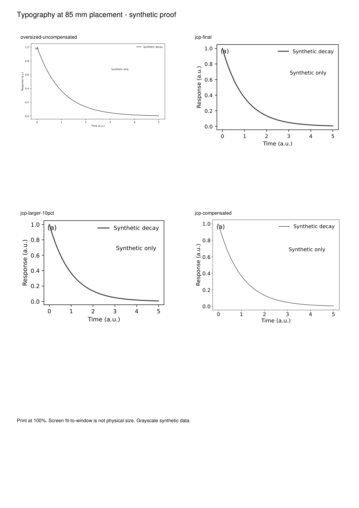

# 0.9.0-rc.1 验证记录

发布前补验（2026-10-30）：创建独立 Windows / Python 3.12 venv，按 README 从 `requirements.txt` 成功安装依赖，清除 `PYTHONPATH` 后完整 **55 项测试通过**。未复用原科研环境的导入路径；pip 可复用下载缓存。GitHub Actions 定义 Windows/Linux 两个平台的测试与合成图导出，运行状态以仓库 Actions 为准。下文“尚未做干净环境安装”为较早本地候选的历史状态，已由本条更新。

2026-10-30 防遮挡更新：完整回归 **55 项通过**（原 37 项 + 18 项布局测试）。新测试覆盖图例后方被遮住的曲线、线段/点/柱/误差带、NaN 间断、画布外文字、热图有意覆盖、子图重排、无解恢复、同名图例对象身份、完整图例条目、异常后的可见性/渲染器恢复、字号变更重检、手动布局边界和导出 warn/error/off 模式。

| 合成场景 | 修复前筛查项 | 修复后 | 实际处理 |
|---|---:|---:|---|
| 不透明图例遮曲线 | 1 | 0 | 有限候选位置搜索 |
| 密集柱图无图内空位 | 1 | 0 | 原位恢复后重建 GridSpec 图例行 |
| 2×2 子图标题、轴标签与相邻面板冲突 | 39 | 0 | 固定画布/字号下重排间距 |
| 长类别刻度文字 | 2 | 0 | 完整文字换行，保留刻度位置 |
| 标题与自由说明文字重叠 | 1 | 0 | 自由说明移至空白角落 |
| 热图格内数值（负对照） | 0 | 0 | 逐对象记录有意覆盖原因，继续检查文字互撞 |

筛查项不是相互独立缺陷数。合成测试共导出 11 对 PDF / 600 dpi PNG，五组前后对照见 [对照 PDF](assets/layout-comparison.pdf)。已查看对照图及修复后 PNG 和独立渲染 PDF；数据、字号、颜色、范围保持不变，长标签仅换行。`adjustText` / `textalloc` 仅调研，未安装运行，未宣称其自动修复效果。

另复测历史科研图 9 对（四张总图及五张独立子图），以及上一轮较大字号图 5 对，共 **14 对实际图**。均为 0 → 0 项新筛查冲突，没有为制造对比强行移动已清楚的图例。核对源图哈希和已有数值保持断言，PNG/PDF 布局均已检查。私有数据与这些实际图不进入发行包。

审计使用当前 Agg 渲染的文字/图例矩形与隔离数据层像素，不是逐字形或 PDF 碰撞认证；低透明度细线、箭头交叉、嵌套/自定义对象、三维图仍需审阅。0.4 mm 等距离是本地预设，不是期刊规定。测试环境沿用下列 Windows 依赖；尚未做干净环境安装或跨平台测试。

## 0.8.0-rc.1 验证记录

2026-10-30 字号更新：完整回归 **37 项通过**（原 28 项 + 9 项新字号测试）。验证最终尺寸逆向补偿、整体倍率与绝对覆盖优先级、全图文字角色、重复应用不叠加、数据/配色/全局 rcParams 不变、超界提示、空文本 PDF 提示、PDF UserUnit 与真实 PDF 字号读数。skill 结构检查通过。

`examples/typography_proof.py` 已实际生成 4 组 PDF/600 dpi PNG 和 A4 原尺寸对照。170 mm 画布的 8 pt 在 85 mm 放置下实测 4 pt；补偿后的 JCP 字体达到设定的最终 8.5/9/10 pt。另用三张历史科研图及两张独立子图测试重排，数据保持不变；私有结果未进入发行包。真实图固定尺寸、PDF 字体及页面边界检查无错误，一张独立图底边距 4.87 mm 触发本地审阅提示，视觉检查后保留。PNG 与独立渲染 PDF 已检查。

期刊限值的警告仍需按角色审阅；数学脚标、APS 实际字形高度、编辑部实际缩放不能靠名义字号自动认证。没有进行纸张打印或跨平台新环境测试。

## 0.7.0-rc.1 原有验证记录

日期：2026-10-30。运行环境：Windows，Python 3.12.14。使用已有本地依赖；未声称在空环境中重新安装成功，也未进行 Linux/macOS 测试。

| 依赖 | 实测版本 |
|---|---|
| Matplotlib | 3.11.2 |
| NumPy | 2.5.4 |
| Pillow | 13.0.0 |
| pypdf | 6.10.0 |
| PyMuPDF | 2.0 |
| Colorspacious | 1.1.2 |

## 自动验证

`python -m unittest discover -s tests -v`：**28 项测试通过**。含子用例的测试没有另行膨胀计数。测试覆盖：

- 未确认不能导出设置；确认可复用；颜色、类别身份/排序、alpha、revision、normalization 变化使旧确认失效；篡改/空白确认拒绝。
- 不合法的对数/周期/发散配置拒绝；灰度保持相对亮度；对比度参考值；三个 CVD 模型输出有限且处于显示范围；审阅不修改/批准色卡。
- 固定尺寸不受外部 tight 设置影响；局部样式退出后恢复；尺寸错误/无效 DPI 拒绝；覆盖需显式指定；渲染失败不留下新的不完整文件对。
- 图外注释筛查；原始数据与 NaN 间断保留；PDF 有可提取文字与矢量路径。
- 非白底边距、空白图、过大边框、无 DPI、PDF UserUnit、缺失输出文件与缺失依赖提示。

skill-creator 的 `quick_validate.py` 格式检查通过。它只验证 skill 结构，不替代行为与视觉检查。

## 实际导出与视觉检查

对 4 组科学图 PDF/PNG 进行尺寸、DPI、字体与边距检查；最终 **0 错误、0 警告**。所有 PNG 600 dpi；尺寸容差 0.25 mm。

| 合成示例 | PDF 目标尺寸 | 外边距范围 |
|---|---|---|
| 总图：分量 profile + 连续场 + 外置图例 | 180 × 52 mm | 0.93–1.31 mm |
| 独立 profile | 89 × 65 mm | 0.93–1.31 mm |
| 独立连续场与本地色条 | 89 × 40 mm | 1.06–2.88 mm |
| 缺失观测间断 | 89 × 65 mm | 0.93–1.19 mm |

另导出三张待确认配色卡与配色筛查页。六份 PDF 均渲染为图片，并检查页面文字边界与字体；未发现图外文字或 Type 3 字体。人工视觉检查核对了 PNG 和 PDF 渲染的整体布局、中文/希腊字母、图例、色条和误差棒。显示缩放不等于实物打样，未做印刷纸张与色彩管理验证。

视觉检查中发现总图色条过长、独立热图上边距偏大，已调整色条锚定与画布高度；未拉伸图像或改动数据。黑色柱体上的误差棒通过背景色窄描边保持可见。

## 两个可量化结果

1. 同一 89 × 65 mm 合成图，外部 `savefig.bbox='tight'` 时旧式 `savefig(..., bbox_inches=None)` 实测导出 **84.33 × 63.95 mm**；新 helper 导出 **89.00 × 65.00 mm**。这是本地失效案例对比，不是外部 skill 排名。
2. Shi/Tanaka F 卡红、蓝两色的灰度 CIE L* 差约 **2.829**，触发 `<5` 的本地审阅提示。保留线型/点型区分；未擅自改变颜色或记录用户同意。D/E 未触发这个特定提示不代表普遍无障碍。

## 未完成的验证边界

- `docs/behavior-evals.md` 是后续真实会话评估集，尚未执行独立模型对照测试。
- 未测试全新依赖安装、Linux/macOS、印刷打样或全部字体环境。
- Science 当前官方规范仍访问受限；NC 部分来源较旧。这轮保留 2026-10-28 的来源状态，没有将其伪装为新核验。
- 新 palette candidates 均未获实际用户确认。单元测试里的确认文本明确只属于合成测试。
